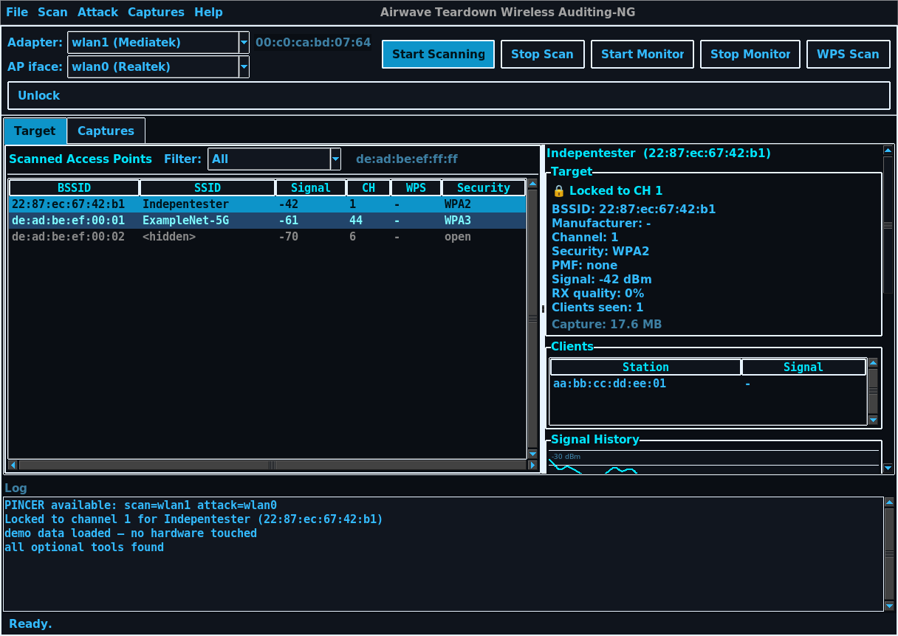

# ATWA-NG

> Airwave Teardown Wireless Auditing — Next Generation. Native WiFi security auditing engine with vendored scanning/cracking binaries, self-contained.


[](LICENSE)
[](https://www.python.org/)
[](https://github.com/KiMiGuel/ATWA-NG/releases)
[](https://pypi.org/project/atwa/)
[](https://github.com/KiMiGuel/ATWA-NG/actions)

**Requires root. Authorized testing only.**

---

## Key Features

- 🔍 **Native scanning** — channel-hopping AP/client discovery with vendor detection.
- 📡 **Monitor mode** — one-click adapter management, MAC randomization on monitor.
- 💥 **Handshake & PMKID capture** — deauth, EAPOL hunt, CSA spoof, rogue-AP downgrades.
- 🔓 **Cracking** — native WPA/WPA2 cracker (no external deps) + John the Ripper integration.
- 🧩 **WEP & WPS** — fake-auth, ARP replay, PTW, Pixie-Dust, null-PIN, bruteforce.
- 🎯 **Smart/OMNI chains** — adaptive multi-stage attack orchestration.
- 🖥️ **Desktop GUI (ATWA-G)** — full Tkinter interface with target tree, captures tab, live log.
- 📦 **Self-contained** — vendored aircrack-ng binaries, no system aircrack needed.

---

## Installation

### One-liner (recommended)

```bash
curl -fsSL https://indepentest.pro/install.sh | bash
```

### PyPI

```bash
pip install atwa
```

### From source

```bash
git clone https://github.com/KiMiGuel/ATWA-NG
cd ATWA-NG && pip install -e .
```

### Prerequisites

- Debian/Ubuntu/Kali (apt-based)
- `iw`, `iproute2`, `ethtool`, `procps`, `python3` (installed by the one-liner)
- Root privileges for monitor mode

---

## ATWA-G GUI Usage Guide



Launch with:

```bash
sudo atwa gui
```

### Primary controls

| Control | What it does |
|---|---|
| **Adapter dropdown** | Selects the scan/monitor interface; shows chipset vendor. |
| **AP iface dropdown** | Selects the separate interface for rogue-AP/downgrade attacks. |
| **Start Scanning / Stop Scan** | Toggles channel-hopping AP/client discovery. |
| **Start Monitor / Stop Monitor** | Puts the selected adapter into/out of monitor mode. |
| **WPS Scan** | Enumerates WPS-enabled access points. |
| **Unlock** | Resumes channel hopping after a lock. |
| **Target tree** | Lists discovered APs and their clients; select a target to populate the Attack panel. |
| **Captures tab** | Inspect, convert, merge, fix and crack captured handshakes. |
| **Log pane** | Live output of every operation. |

### Standard session workflow

1. Pick your **Adapter** (and **AP iface** if running rogue-AP attacks).
2. **Start Monitor**, then **Start Scanning**.
3. Select a target AP in the **Target tree**.
4. Run an attack from the **Attack** menu (Deauth, PMKID, Handshake, Smart, OMNI, …).
5. Inspect results in the **Captures** tab; crack with the selected wordlist.

---

## Quick Start (CLI)

```bash
sudo atwa injection-test
sudo atwa scan --iface wlan0
sudo atwa omni --iface wlan0 --bssid AA:BB:CC:DD:EE:FF --ssid NET
sudo atwa crack ~/atwa-hs/NET_AA:BB:CC:DD:EE:FF/handshake-01.cap
sudo atwa gui
```

## Command Reference

| Command | Description |
|---|---|
| `scan` | Channel-hopping AP/client scan |
| `injection-test` | Injection self-test |
| `wps-recon` | WPS-enabled AP reconnaissance |
| `eapol-hunt` | Passive EAPOL handshake capture |
| `verify-handshake` | Verify a captured handshake |
| `handshake` | 4-way handshake capture |
| `pmkid` | Clientless PMKID capture |
| `crack-cap` / `crack` | Crack a capture / 22000 file |
| `deauth` | Deauth flood |
| `chaos` | Coordinated multi-vector flood |
| `omni` | Adaptive chain: pmkid → handshake → crack |
| `smart` | PMKID → deauth + handshake |
| `wep` / `wep-hirte` | Fake-auth + ARP replay + PTW |
| `wps-pixie` / `wps-oneshot` | Pixie-Dust / WPS via wpa_supplicant |
| `downgrade-twin` / `owe-downgrade` / `pmf-bypass` | Rogue-AP downgrade |
| `dragonblood` | SAE timing side-channel pruning |
| `gui` | Desktop GUI |
| `update` | Install a newer release |

Full guide: [`docs/usage.md`](docs/usage.md).

---

## Configuration

No config file. Fixed conventions:

- **Captures** → `~/atwa-hs/<SSID>_<BSSID>/`
- **Global flags** → `--help`, `--version`
- **Per-command** → `atwa <command> --help`
- **Settings** (wordlist, John ruleset, capture dir, adapters) → saved via the GUI *File* menu.

---

## Contributing

Contributions welcome. See [CONTRIBUTING.md](CONTRIBUTING.md). Please keep changes consistent with the existing style and run the test suite before submitting.

## License

[MIT](LICENSE) — © KiMiGuel / INDEPENTEST LLC.
