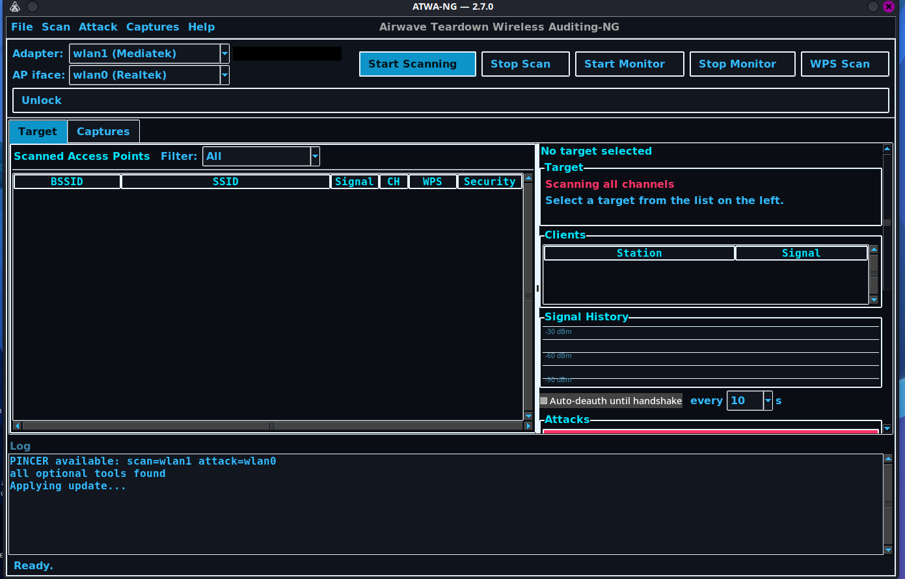
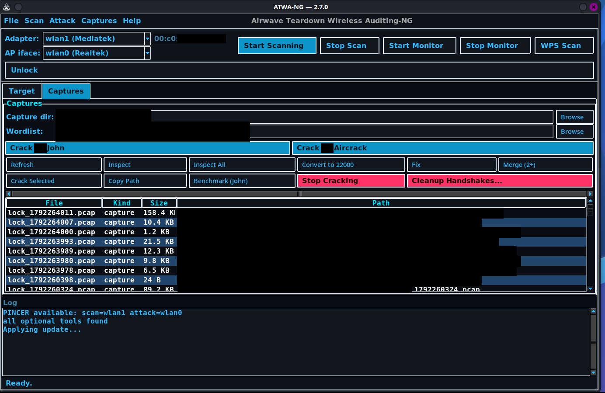

# ATWA-NG — Usage



Short version: [README](../README.md).

## Setup
- Two adapters recommended: `wlan0` = internet, `wlan1` = monitor.
- Modern NetworkManager (>= 1.0.12) doesn't need killing. Force it:
  `ATWA_FORCE_NETWORK_MANAGER_KILLING=0|1`.

## Launch
```bash
sudo atwa gui
```

## Main window
- **Adapter** dropdown: pick the scan/monitor adapter.
- **AP iface** dropdown: pick the adapter used for rogue-AP/attack injection.
- **Start Monitor / Stop Monitor**: toggle monitor mode on the selected adapter.
- **Start Scan / Stop Scan**: channel-hopping scan.
- **Filter**: filter the AP list.
- **Channel lock**: double-click a target to lock; click **Unlock** to resume hopping.

Scan results show SSID, BSSID, channel, signal, security, clients. Select a target to see clients and signal history.

## Attacks tab
Buttons:
- **Deauth** — disassociate selected client or broadcast.
- **Auth/Beacon/EAPOL/CSA/TKIP-MIC floods** — pressure vectors.
- **CHAOS** — runs all vectors at 100/1000/5000 frames.
- **Smart / Omni** — automated chains.
- **Stop Attack** — aborts the running attack.

## Captures tab


- **Wordlist** — choose a wordlist file.
- **Crack w/ John / Crack w/ Aircrack** — crack selected capture.
- **Lock captures** — list of `lock_*.pcap` files with sizes and paths.
- Lock a target with clients to start a capture; unlock to stop.

## WPS
- **WPS recon** lists WPS-enabled APs.
- **WPS Pixie** / **WPS Oneshot** run against the selected target.

## Log
Live status and errors. Watch here for socket deaths, NM issues, and stop confirmations.

## Cleanup
- **Stop Attack** stops the current job.
- **Stop Monitor** returns the adapter to managed mode and re-enables NM.
- On exit ATWA restores everything. If NM was killed (old NM), run:
  `sudo systemctl restart NetworkManager`.
- Stuck unmanaged adapter: `sudo nmcli device set <iface> managed yes`.

## Troubleshooting
- **Few targets / one channel:** unlock channel lock.
- **Socket died (ENETDOWN):** interface flap during active-monitor toggle; scan auto-restarts.
- **No internet during run:** NM killed. Use two adapters or restart NM after.
- **Deauth does nothing:** raise TX power, move closer, confirm monitor mode.